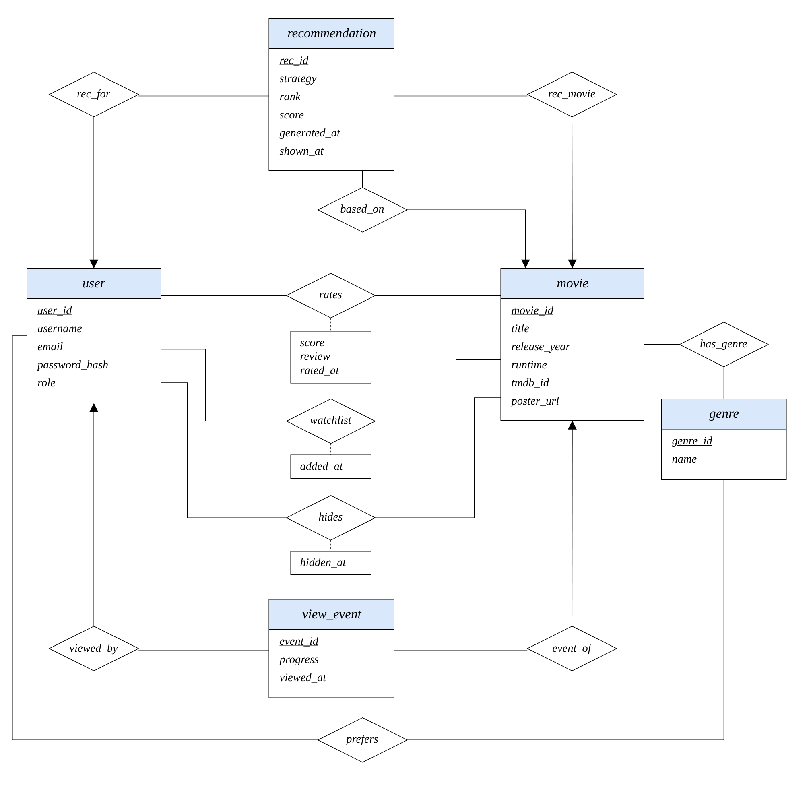
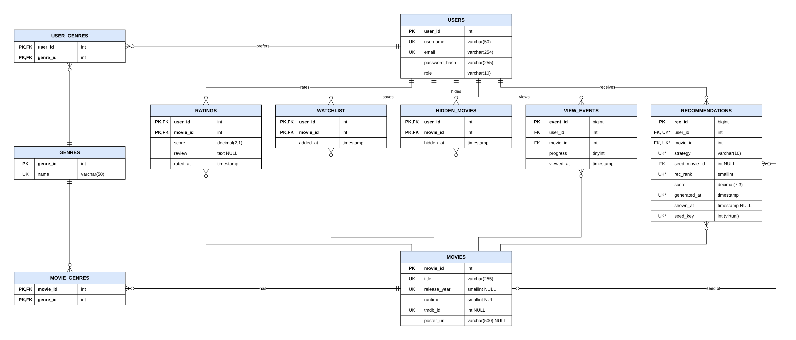

# Recco — Part 2: Relational Database Design

**Course:** CS-GY 6083 · Self-proposed project

**Team:** Jonghyun Jeong (jj4335), Seho Kim (sk13811), Harry Song (cs8293)

# 1. Introduction

**Recco** is a movie recommendation web application. Users rate and review movies, keep a watchlist, hide titles they are not interested in, continue watching where they left off, and receive ranked recommendations. Administrators manage the catalogue and refresh the recommendations.

This document covers Part 2: the relational schema derived from the Part 1 ER model, the table definitions in SQL, a hand-crafted sample data set and 11 queries with their results. Everything targets **MySQL 8.0** and was run on MySQL 8.0.46 with the default strict SQL mode.

| File | Purpose |
| --- | --- |
| sql/01_schema.sql | DDL: 10 tables, keys, constraints, indexes |
| sql/02_sample_data.sql | Hand-crafted sample data |
| sql/03_queries.sql | The 11 queries as the application sends them (%(name)s placeholders) |
| sql/04_test_queries.sql | The same queries with concrete values, used for the results below |
| results/test_results.txt | Full output of running 04_test_queries.sql |
| diagrams/ | ER diagram and relational schema diagram (draw.io source and PNG) |

# 2. From the ER model to tables

Each part of the ER model maps to tables by the standard rules. The result is 10 tables.

| ER element | Kind | Becomes |
| --- | --- | --- |
| user, movie, genre | Entity sets | users, movies, genres; each key attribute becomes the primary key |
| view\_event, recommendation | Entity sets with their own key | view\_events, recommendations, with surrogate keys event\_id and rec\_id |
| rates (score, review, rated\_at) | Many-to-many with attributes | ratings; PK (user\_id, movie\_id), the relationship attributes become columns |
| watchlist (added\_at), hides (hidden\_at) | Many-to-many with attributes | watchlist, hidden\_movies; PK (user\_id, movie\_id) |
| has\_genre, prefers | Many-to-many | movie\_genres, user\_genres; PK is the pair of foreign keys |
| viewed\_by, event\_of | Many-to-one, total participation | NOT NULL foreign keys view\_events.user\_id and view\_events.movie\_id |
| rec\_for, rec\_movie | Many-to-one, total participation | NOT NULL foreign keys recommendations.user\_id and recommendations.movie\_id |
| based\_on | Many-to-one, partial participation | Nullable foreign key recommendations.seed\_movie\_id |

{width=5.6in}

A many-to-one relationship does not need a table of its own: the foreign key on the "many" side records it. Total participation (double line in the ER diagram) becomes NOT NULL, and partial participation becomes a nullable column.

## 2.1 Changes since the proposal

1. **rank is now rec\_rank.** RANK is a reserved word in MySQL 8, so a column named rank would need backticks in every query.
2. **seed\_key, a virtual generated column, equals COALESCE(seed\_movie\_id, 0).** MySQL treats NULLs as distinct in UNIQUE indexes, so a plain UNIQUE (…, seed\_movie\_id, …, rec\_rank) would accept two rank-1 rows in a list that has no seed movie. We tested this on MySQL 8.0: a plain index accepted both rows. Both UNIQUE keys of a list therefore use seed\_key.
3. **release\_year and runtime are nullable.** Some MovieLens titles have no year, and MovieLens has no runtimes. The CHECK constraints still apply whenever a value is present.
4. **The 24-hour rule is defined precisely.** Once a movie is shown in a personal list (genre or item\_cf), it is neither put into nor shown from another personal list for 24 hours, counted from the first time it was shown. Refreshing the page shows the same list again. The popular charts are rankings, so they are exempt in both directions.

# 3. Relational schema

**Notation:** PK columns are in bold, and → shows the table a foreign key references.

- users (**user\_id**, username, email, password\_hash, role)
- genres (**genre\_id**, name)
- movies (**movie\_id**, title, release\_year, runtime, tmdb\_id, poster\_url)
- movie\_genres (**movie\_id** → movies, **genre\_id** → genres)
- user\_genres (**user\_id** → users, **genre\_id** → genres)
- ratings (**user\_id** → users, **movie\_id** → movies, score, review, rated\_at)
- view\_events (**event\_id**, user\_id → users, movie\_id → movies, progress, viewed\_at)
- watchlist (**user\_id** → users, **movie\_id** → movies, added\_at)
- hidden\_movies (**user\_id** → users, **movie\_id** → movies, hidden\_at)
- recommendations (**rec\_id**, user\_id → users, movie\_id → movies, strategy, seed\_movie\_id → movies, rec\_rank, score, generated\_at, shown\_at, seed\_key)

{width=6.8in}

In the diagram, UK\* marks the columns of the two composite UNIQUE keys of a recommendation list: one row per rank, and one row per movie, in each list. In movies, title and release\_year form one composite UNIQUE key, and tmdb\_id is unique on its own.

# 4. Table definitions

The full DDL is in sql/01_schema.sql and reproduced in Appendix A. The script drops and recreates all 10 tables, so it can be re-run safely.

| Table | Primary key | Main constraints |
| --- | --- | --- |
| users | user\_id (INT AUTO\_INCREMENT) | UNIQUE username, email; role IN ('user','admin'); email format CHECK |
| genres | genre\_id (INT AUTO\_INCREMENT) | UNIQUE name |
| movies | movie\_id (INT AUTO\_INCREMENT) | UNIQUE (title, release\_year); UNIQUE tmdb\_id; year 1870–2100; runtime > 0 |
| movie\_genres | (movie\_id, genre\_id) | CASCADE on movie; RESTRICT on genre |
| user\_genres | (user\_id, genre\_id) | CASCADE on both |
| ratings | (user\_id, movie\_id) | score DECIMAL(2,1) in 0.5 steps from 0.5 to 5.0; index (movie\_id, score) |
| view\_events | event\_id (BIGINT AUTO\_INCREMENT) | progress 0–100; indexes (user\_id, viewed\_at), (movie\_id, viewed\_at) |
| watchlist | (user\_id, movie\_id) | CASCADE on both |
| hidden\_movies | (user\_id, movie\_id) | CASCADE on both |
| recommendations | rec\_id (BIGINT AUTO\_INCREMENT) | strategy IN ('popular','genre','item\_cf'); rec\_rank ≥ 1; two UNIQUE keys per list; index (user\_id, shown\_at) |

**Constraint choices**

- **Half-star scale in the database.** CHECK (score BETWEEN 0.5 AND 5.0 AND score \* 2 = FLOOR(score \* 2)) accepts 3.5 and rejects 4.3, whatever the application sends.
- **ON DELETE CASCADE** on every interaction table, so removing a user or a movie cleans up its ratings, views, watchlist entries, hides and recommendations.
- **ON DELETE RESTRICT** from movie\_genres to genres: a genre still used by a movie cannot be deleted.
- **seed\_movie\_id cascades too:** a "Because you liked X" list is deleted with X, since it means nothing without it.
- **Indexes follow the queries:** (movie\_id, score) for the collaborative self-join, (movie\_id, viewed\_at) for trending, and (user\_id, shown\_at) for the 24-hour rule.

Loading 01_schema.sql creates the 10 tables with no warnings.

# 5. Sample data

The data set is small on purpose, with every corner case the queries must handle appearing at least once. It has 7 users (1 admin, 5 users with history and 1 brand-new user), 6 genres, 20 movies, 56 ratings, 19 viewing events, 3 watchlist entries, 1 hidden movie and 5 earlier recommendation rows. All times are relative to NOW(), so the results stay the same whenever the script runs.

```text
+-----------------+----+
| tbl             | n  |
+-----------------+----+
| users           |  7 |
| genres          |  6 |
| movies          | 20 |
| movie_genres    | 35 |
| user_genres     | 18 |
| ratings         | 56 |
| view_events     | 19 |
| watchlist       |  3 |
| hidden_movies   |  1 |
| recommendations |  5 |
+-----------------+----+
```

**Corner cases built in**

- **Liked threshold:** carol rated The Matrix 3.5, just under the 4.0 "liked" line, so she must not count as someone who liked it (Q7).
- **Single vote:** Parasite has one 5.0 vote and must not top any chart (Q5, Q6).
- **7-day window:** The Godfather has two views older than 7 days and one inside, so trending counts 1, not 3 (Q4).
- **Latest view wins:** for alice, Shrek went 20% → 70% (still in progress), and La La Land went 50% → 92% (now finished) (Q3).
- **Exclusions:** alice finished Jurassic Park and hid Mad Max: Fury Road, so neither may be recommended to her (Q6, Q7).
- **24-hour rule:** The Godfather was shown to alice 3 hours ago, so it is held back. Pulp Fiction was shown 2 days ago, so it is allowed again (Q6, Q7).
- **Cold start:** frank has no ratings, only favourite genres (Q6).
- **Roles:** user 1 is an admin, and everyone else is a regular user (Q10).

# 6. Queries and results

Each query below is the application version from sql/03_queries.sql. The results come from running sql/04_test_queries.sql, which uses the same queries with concrete values, top to bottom on a fresh load of the schema and sample data. The statements marked "expected error" are meant to fail: they show a constraint at work.

## 6.1 Q1 — Sign up with favourite genres (use case 1)

```sql
START TRANSACTION;
INSERT INTO users (username, email, password_hash, role)
SELECT %(username)s, %(email)s, %(password_hash)s, 'user'
FROM   DUAL
WHERE  (SELECT COUNT(*) FROM genres WHERE genre_id IN %(genre_ids)s) = 3;   -- exactly 3 distinct, existing genres
-- if cursor.rowcount == 0: ROLLBACK and ask for three valid genres
-- new_user_id = cursor.lastrowid
INSERT INTO user_genres (user_id, genre_id)
SELECT %(new_user_id)s, genre_id
FROM   genres
WHERE  genre_id IN %(genre_ids)s;
COMMIT;
```

The account is created only if the form sent exactly three distinct genres that exist: the INSERT … SELECT counts them first and inserts nothing otherwise. Both inserts run in one transaction, so a failure leaves neither the user nor their genres behind. Test 1a: grace picks Animation, Comedy and Romance. Test 1b: heidi picks Comedy, Drama and Western, a genre that does not exist, and no account is created. A duplicate genre fails the same way, because only distinct genres are counted. Finally, signing up again with grace's email is rejected by users\_email\_uq.

```text
-- 1a
INSERT: 1 row(s) affected
INSERT: 3 row(s) affected
+---------+----------+---------------+------+----------------------------+
| user_id | username | email         | role | favourite_genres           |
+---------+----------+---------------+------+----------------------------+
| 8       | grace    | grace@nyu.edu | user | Animation, Comedy, Romance |
+---------+----------+---------------+------+----------------------------+
-- 1b
INSERT: 0 row(s) affected
INSERT: 0 row(s) affected
+-------------+--------------+
| heidi_users | heidi_genres |
+-------------+--------------+
| 0           | 0            |
+-------------+--------------+
ERROR 1062: Duplicate entry 'grace@nyu.edu' for key 'users.users_email_uq'
```

## 6.2 Q2 — Rate or re-rate a movie (use case 3)

```sql
INSERT INTO ratings (user_id, movie_id, score, review)
VALUES (%(user_id)s, %(movie_id)s, %(score)s, %(review)s) AS new
ON DUPLICATE KEY UPDATE score    = new.score,
                        review   = new.review,
                        rated_at = CURRENT_TIMESTAMP;
```

One upsert covers both a first rating and a change of mind, because the primary key (user\_id, movie\_id) turns the second INSERT into an UPDATE. MySQL reports 1 affected row for an insert and 2 for an update. Test: bob rates The Dark Knight 3.0 and then 4.5, and exactly one row remains. A score of 4.3 is rejected by ratings\_score\_chk.

```text
INSERT: 1 row(s) affected
INSERT: 2 row(s) affected
+---------+----------+-------+-------------------------+
| user_id | movie_id | score | review                  |
+---------+----------+-------+-------------------------+
| 3       | 9        | 4.5   | Better the second time. |
+---------+----------+-------+-------------------------+
ERROR 3819: Check constraint 'ratings_score_chk' is violated.
```

## 6.3 Q3 — Continue watching (use case 7)

```sql
SELECT m.movie_id, m.title, lv.progress, lv.viewed_at AS last_viewed
FROM  (SELECT ve.movie_id, ve.progress, ve.viewed_at,
              ROW_NUMBER() OVER (PARTITION BY ve.movie_id
                                 ORDER BY ve.viewed_at DESC, ve.event_id DESC) AS rn
       FROM   view_events ve
       WHERE  ve.user_id = %(user_id)s) AS lv
JOIN   movies m ON m.movie_id = lv.movie_id
WHERE  lv.rn = 1
  AND  lv.progress < 90
ORDER BY lv.viewed_at DESC;
```

ROW_NUMBER() keeps only the latest event per movie, and the row is shown only if that event is below 90%. For alice, Shrek appears at 70% (its latest view, not the earlier 20%). La La Land is gone because its latest view reached 92%, and Jurassic Park (95%) never appears.

```text
+----------+----------+----------+---------------------+
| movie_id | title    | progress | last_viewed         |
+----------+----------+----------+---------------------+
| 19       | Superbad | 35       | 2026-11-06 22:57:04 |
| 3        | Shrek    | 70       | 2026-11-05 22:57:04 |
+----------+----------+----------+---------------------+
```

## 6.4 Q4 — Trending this week (use case 9)

```sql
SELECT m.movie_id, m.title,
       COUNT(DISTINCT ve.user_id) AS viewers,
       COUNT(*)                   AS views
FROM   view_events ve
JOIN   movies m ON m.movie_id = ve.movie_id
WHERE  ve.viewed_at >= NOW() - INTERVAL 7 DAY
GROUP BY m.movie_id, m.title
ORDER BY viewers DESC, views DESC, m.title
LIMIT 10;
```

Movies are ranked by distinct viewers in the last 7 days, then by total views. Interstellar leads with 3 viewers. The Godfather counts 1 viewer, not 3, because two of its views are older than 7 days, and Parasite (watched 20 days ago) does not appear.

```text
+----------+---------------+---------+-------+
| movie_id | title         | viewers | views |
+----------+---------------+---------+-------+
| 8        | Interstellar  | 3       | 3     |
| 15       | Forrest Gump  | 2       | 2     |
| 12       | Titanic       | 2       | 2     |
| 3        | Shrek         | 1       | 2     |
| 11       | Jurassic Park | 1       | 1     |
| 14       | La La Land    | 1       | 1     |
| 19       | Superbad      | 1       | 1     |
| 16       | The Godfather | 1       | 1     |
| 4        | Up            | 1       | 1     |
+----------+---------------+---------+-------+
```

## 6.5 Q5 — Top-rated movies per genre (use case 9)

```sql
WITH movie_stats AS (
    SELECT movie_id, AVG(score) AS avg_score, COUNT(*) AS n_ratings
    FROM   ratings
    GROUP BY movie_id
    HAVING COUNT(*) >= 3
), ranked AS (
    SELECT g.name AS genre, m.title, ms.avg_score, ms.n_ratings,
           ROW_NUMBER() OVER (PARTITION BY g.genre_id
                              ORDER BY ms.avg_score DESC, ms.n_ratings DESC, m.title) AS pos
    FROM   movie_stats ms
    JOIN   movies m        ON m.movie_id  = ms.movie_id
    JOIN   movie_genres mg ON mg.movie_id = ms.movie_id
    JOIN   genres g        ON g.genre_id  = mg.genre_id
)
SELECT genre, pos, title, ROUND(avg_score, 2) AS avg_score, n_ratings
FROM   ranked
WHERE  pos <= 3
ORDER BY genre, pos;
```

Only movies with at least 3 ratings are ranked, and ROW_NUMBER() keeps the top 3 per genre. Parasite has the highest average in Drama (5.0), but only one vote, so The Godfather leads Drama instead.

```text
+-----------+-----+---------------+-----------+-----------+
| genre     | pos | title         | avg_score | n_ratings |
+-----------+-----+---------------+-----------+-----------+
| Action    | 1   | Inception     | 4.33      | 3         |
| Action    | 2   | The Matrix    | 4.25      | 4         |
| Action    | 3   | Jurassic Park | 4.17      | 3         |
| Animation | 1   | Spirited Away | 4.50      | 3         |
| Animation | 2   | Up            | 4.50      | 3         |
| Animation | 3   | Shrek         | 4.00      | 3         |
| Comedy    | 1   | Forrest Gump  | 4.50      | 4         |
| Comedy    | 2   | La La Land    | 4.00      | 3         |
| Comedy    | 3   | Shrek         | 4.00      | 3         |
| Drama     | 1   | The Godfather | 4.67      | 3         |
| Drama     | 2   | Forrest Gump  | 4.50      | 4         |
| Drama     | 3   | Interstellar  | 4.50      | 3         |
| Romance   | 1   | Forrest Gump  | 4.50      | 4         |
| Romance   | 2   | La La Land    | 4.00      | 3         |
| Romance   | 3   | The Notebook  | 4.00      | 3         |
| Sci-Fi    | 1   | Interstellar  | 4.50      | 3         |
| Sci-Fi    | 2   | Inception     | 4.33      | 3         |
| Sci-Fi    | 3   | The Matrix    | 4.25      | 4         |
+-----------+-----+---------------+-----------+-----------+
```

## 6.6 Q6 — Genre-based picks (use case 8)

```sql
WITH taste AS (            -- favourite genres + genres of movies rated 4.0 or higher
    SELECT ug.genre_id FROM user_genres ug WHERE ug.user_id = %(user_id)s
    UNION
    SELECT mg.genre_id
    FROM   ratings r
    JOIN   movie_genres mg ON mg.movie_id = r.movie_id
    WHERE  r.user_id = %(user_id)s AND r.score >= 4.0
), movie_stats AS (        -- same minimum of 3 ratings as Q5
    SELECT movie_id, AVG(score) AS avg_score, COUNT(*) AS n_ratings
    FROM   ratings
    GROUP BY movie_id
    HAVING COUNT(*) >= 3
)
SELECT m.movie_id, m.title, ROUND(s.avg_score, 2) AS avg_score, s.n_ratings
FROM   movies m
JOIN   movie_stats s ON s.movie_id = m.movie_id
WHERE  EXISTS (SELECT 1 FROM movie_genres mg
               JOIN   taste t ON t.genre_id = mg.genre_id
               WHERE  mg.movie_id = m.movie_id)
  AND  NOT EXISTS (SELECT 1 FROM ratings r                       -- already rated
                   WHERE r.user_id = %(user_id)s AND r.movie_id = m.movie_id)
  AND  NOT EXISTS (SELECT 1 FROM view_events ve                  -- already finished
                   WHERE ve.user_id = %(user_id)s AND ve.movie_id = m.movie_id
                     AND ve.progress >= 90)
  AND  NOT EXISTS (SELECT 1 FROM hidden_movies h                 -- hidden
                   WHERE h.user_id = %(user_id)s AND h.movie_id = m.movie_id)
  AND  NOT EXISTS (SELECT 1 FROM recommendations rc              -- shown in last 24 h
                   WHERE rc.user_id = %(user_id)s AND rc.movie_id = m.movie_id
                     AND rc.strategy <> 'popular'       -- chart displays do not count
                     AND rc.shown_at >= NOW() - INTERVAL 1 DAY)
ORDER BY s.avg_score DESC, s.n_ratings DESC, m.title
LIMIT 10;
```

The taste CTE collects the user's favourite genres plus the genres of every movie they rated 4.0 or higher. Candidates need at least 3 ratings, and four NOT EXISTS checks remove movies that are rated, finished, hidden or shown in a personal list in the last 24 hours.

**6a — alice.** The six picks come from Action, Sci-Fi and Drama. Four movies in those genres are correctly missing: The Godfather (shown 3 hours ago), Mad Max: Fury Road (hidden), Jurassic Park (finished) and Parasite (one rating). Pulp Fiction appears because it was last shown 2 days ago.

**6b — frank** (brand-new, no ratings). His favourite genres alone produce 8 picks, so even a new user gets personal recommendations.

```text
-- 6a
+----------+--------------+-----------+-----------+
| movie_id | title        | avg_score | n_ratings |
+----------+--------------+-----------+-----------+
| 15       | Forrest Gump | 4.50      | 4         |
| 8        | Interstellar | 4.50      | 3         |
| 4        | Up           | 4.50      | 3         |
| 17       | Pulp Fiction | 4.00      | 3         |
| 13       | The Notebook | 4.00      | 3         |
| 12       | Titanic      | 4.00      | 3         |
+----------+--------------+-----------+-----------+
-- 6b
+----------+---------------+-----------+-----------+
| movie_id | title         | avg_score | n_ratings |
+----------+---------------+-----------+-----------+
| 15       | Forrest Gump  | 4.50      | 4         |
| 5        | Spirited Away | 4.50      | 3         |
| 4        | Up            | 4.50      | 3         |
| 14       | La La Land    | 4.00      | 3         |
| 3        | Shrek         | 4.00      | 3         |
| 13       | The Notebook  | 4.00      | 3         |
| 12       | Titanic       | 4.00      | 3         |
| 1        | Toy Story     | 3.50      | 3         |
+----------+---------------+-----------+-----------+
```

*Implementation note:* we first wrote the genre test as mg.genre\_id IN (SELECT … UNION SELECT …) inside the EXISTS. In our tests on MySQL 8.0.46, that form silently dropped movies whose first-listed genre did not match. Computing the user's genres once in the taste CTE and joining to it gives the correct result, and it is also easier to read.

## 6.7 Q7 — "Because you liked X" (use case 8)

```sql
SELECT m.movie_id, m.title,
       COUNT(*)             AS co_raters,
       ROUND(AVG(r.score), 2) AS avg_co_score
FROM   ratings r
JOIN   movies  m ON m.movie_id = r.movie_id
WHERE  r.user_id IN (SELECT x.user_id FROM ratings x            -- people who liked X
                     WHERE x.movie_id = %(seed_movie_id)s
                       AND x.score   >= 4.0
                       AND x.user_id <> %(user_id)s)
  AND  r.score    >= 4.0                                        -- ... and also liked this
  AND  r.movie_id <> %(seed_movie_id)s
  AND  NOT EXISTS (SELECT 1 FROM ratings r2
                   WHERE r2.user_id = %(user_id)s AND r2.movie_id = m.movie_id)
  AND  NOT EXISTS (SELECT 1 FROM view_events ve
                   WHERE ve.user_id = %(user_id)s AND ve.movie_id = m.movie_id
                     AND ve.progress >= 90)
  AND  NOT EXISTS (SELECT 1 FROM hidden_movies h
                   WHERE h.user_id = %(user_id)s AND h.movie_id = m.movie_id)
  AND  NOT EXISTS (SELECT 1 FROM recommendations rc
                   WHERE rc.user_id = %(user_id)s AND rc.movie_id = m.movie_id
                     AND rc.strategy <> 'popular'       -- chart displays do not count
                     AND rc.shown_at >= NOW() - INTERVAL 1 DAY)
GROUP BY m.movie_id, m.title
ORDER BY co_raters DESC, avg_co_score DESC, m.title
LIMIT 10;
```

The query finds the other users who rated X at 4.0 or higher, takes the other movies those users also rated at 4.0 or higher, and ranks the movies by how many of those users they share. For alice and X = The Matrix, the co-raters are bob (4.5) and eve (4.0). carol (3.5) is not one of them, so Spirited Away, which only carol liked among Matrix raters, does not appear. That shows the half-star threshold at work. The Godfather (shown 3 hours ago), Mad Max (hidden) and Jurassic Park (finished) are excluded as in Q6.

```text
+----------+--------------+-----------+--------------+
| movie_id | title        | co_raters | avg_co_score |
+----------+--------------+-----------+--------------+
| 8        | Interstellar | 2         | 4.75         |
| 15       | Forrest Gump | 2         | 4.50         |
| 17       | Pulp Fiction | 2         | 4.25         |
| 2        | Finding Nemo | 1         | 4.50         |
| 4        | Up           | 1         | 4.50         |
| 13       | The Notebook | 1         | 4.00         |
+----------+--------------+-----------+--------------+
```

## 6.8 Q8 — Regenerate a user's ranked lists (use case 12)

```sql
-- gen_at: one timestamp for the whole run, e.g. datetime.now(timezone.utc)

-- 8a: genre-based list
INSERT INTO recommendations
       (user_id, movie_id, strategy, seed_movie_id, rec_rank, score, generated_at)
WITH taste AS (            -- favourite genres + genres of movies rated 4.0 or higher
    SELECT ug.genre_id FROM user_genres ug WHERE ug.user_id = %(user_id)s
    UNION
    SELECT mg.genre_id
    FROM   ratings r
    JOIN   movie_genres mg ON mg.movie_id = r.movie_id
    WHERE  r.user_id = %(user_id)s AND r.score >= 4.0
), movie_stats AS (        -- same minimum of 3 ratings as Q5
    SELECT movie_id, AVG(score) AS avg_score, COUNT(*) AS n_ratings
    FROM   ratings
    GROUP BY movie_id
    HAVING COUNT(*) >= 3
), candidates AS (
    SELECT m.movie_id, m.title, s.avg_score, s.n_ratings
    FROM   movies m
    JOIN   movie_stats s ON s.movie_id = m.movie_id
    WHERE  EXISTS (SELECT 1 FROM movie_genres mg
                   JOIN   taste t ON t.genre_id = mg.genre_id
                   WHERE  mg.movie_id = m.movie_id)
      AND  NOT EXISTS (SELECT 1 FROM ratings r                       -- already rated
                       WHERE r.user_id = %(user_id)s AND r.movie_id = m.movie_id)
      AND  NOT EXISTS (SELECT 1 FROM view_events ve                  -- already finished
                       WHERE ve.user_id = %(user_id)s AND ve.movie_id = m.movie_id
                         AND ve.progress >= 90)
      AND  NOT EXISTS (SELECT 1 FROM hidden_movies h                 -- hidden
                       WHERE h.user_id = %(user_id)s AND h.movie_id = m.movie_id)
      AND  NOT EXISTS (SELECT 1 FROM recommendations rc              -- shown in last 24 h
                       WHERE rc.user_id = %(user_id)s AND rc.movie_id = m.movie_id
                         AND rc.strategy <> 'popular'       -- chart displays do not count
                         AND rc.shown_at >= NOW() - INTERVAL 1 DAY)
    ORDER BY s.avg_score DESC, s.n_ratings DESC, m.title
    LIMIT 10
)
SELECT %(user_id)s, c.movie_id, 'genre', NULL,
       ROW_NUMBER() OVER (ORDER BY c.avg_score DESC, c.n_ratings DESC, c.title),
       ROUND(c.avg_score, 3), %(gen_at)s
FROM   candidates c;

-- 8b: popular list (a chart: no 24-hour rule)
INSERT INTO recommendations
       (user_id, movie_id, strategy, seed_movie_id, rec_rank, score, generated_at)
WITH trending AS (         -- Q4: distinct viewers in the last 7 days
    SELECT ve.movie_id, COUNT(DISTINCT ve.user_id) AS viewers, COUNT(*) AS views
    FROM   view_events ve
    WHERE  ve.viewed_at >= NOW() - INTERVAL 7 DAY
    GROUP BY ve.movie_id
), candidates AS (         -- a chart: no 24-hour rule, but skip what the user has seen
    SELECT t.movie_id, m.title, t.viewers, t.views
    FROM   trending t
    JOIN   movies m ON m.movie_id = t.movie_id
    WHERE  TRUE
      AND  NOT EXISTS (SELECT 1 FROM ratings r
                       WHERE r.user_id = %(user_id)s AND r.movie_id = m.movie_id)
      AND  NOT EXISTS (SELECT 1 FROM view_events ve
                       WHERE ve.user_id = %(user_id)s AND ve.movie_id = m.movie_id
                         AND ve.progress >= 90)
      AND  NOT EXISTS (SELECT 1 FROM hidden_movies h
                       WHERE h.user_id = %(user_id)s AND h.movie_id = m.movie_id)
    ORDER BY t.viewers DESC, t.views DESC, m.title
    LIMIT 10
)
SELECT %(user_id)s, c.movie_id, 'popular', NULL,
       ROW_NUMBER() OVER (ORDER BY c.viewers DESC, c.views DESC, c.title),
       c.viewers, %(gen_at)s
FROM   candidates c;

-- 8c: "Because you liked X" list, one per seed movie X
INSERT INTO recommendations
       (user_id, movie_id, strategy, seed_movie_id, rec_rank, score, generated_at)
WITH candidates AS (       -- Q7 for the seed movie
    SELECT m.movie_id, m.title,
           COUNT(*)     AS co_raters,
           AVG(r.score) AS avg_co_score
    FROM   ratings r
    JOIN   movies  m ON m.movie_id = r.movie_id
    WHERE  r.user_id IN (SELECT x.user_id FROM ratings x
                         WHERE x.movie_id = %(seed_movie_id)s
                           AND x.score   >= 4.0
                           AND x.user_id <> %(user_id)s)
      AND  r.score    >= 4.0
      AND  r.movie_id <> %(seed_movie_id)s
      AND  NOT EXISTS (SELECT 1 FROM ratings r
                       WHERE r.user_id = %(user_id)s AND r.movie_id = m.movie_id)
      AND  NOT EXISTS (SELECT 1 FROM view_events ve
                       WHERE ve.user_id = %(user_id)s AND ve.movie_id = m.movie_id
                         AND ve.progress >= 90)
      AND  NOT EXISTS (SELECT 1 FROM hidden_movies h
                       WHERE h.user_id = %(user_id)s AND h.movie_id = m.movie_id)
      AND  NOT EXISTS (SELECT 1 FROM recommendations rc
                       WHERE rc.user_id = %(user_id)s AND rc.movie_id = m.movie_id
                         AND rc.strategy <> 'popular'       -- chart displays do not count
                         AND rc.shown_at >= NOW() - INTERVAL 1 DAY)
    GROUP BY m.movie_id, m.title
    ORDER BY co_raters DESC, avg_co_score DESC, m.title
    LIMIT 10
)
SELECT %(user_id)s, c.movie_id, 'item_cf', %(seed_movie_id)s,
       ROW_NUMBER() OVER (ORDER BY c.co_raters DESC, c.avg_co_score DESC, c.title),
       c.co_raters, %(gen_at)s
FROM   candidates c;
```

One INSERT … SELECT per strategy stores a whole list. ROW_NUMBER() assigns rec\_rank, and one generated\_at is shared by the whole regeneration run. A list is identified by strategy, seed movie and generated\_at, so the three lists of one run never collide. 8a stores the Q6 picks (score = average rating). 8b stores the Q4 chart minus movies the user has rated, finished or hidden (score = viewers). 8c stores the Q7 picks for the seed movie X (score = co-raters), the case where seed\_movie\_id is filled in. Test: alice's three lists hold 6, 7 and 6 rows. Adding a second rank 1 to her genre list is rejected by rec\_list\_rank\_uq, even though seed\_movie\_id is NULL, because the key uses seed\_key.

```text
-- 8a
INSERT: 6 row(s) affected
ERROR 1062: Duplicate entry '2-genre-0-2026-11-07 22:57:04-1' for key 'recommendations.rec_list_rank_uq'
-- 8b
INSERT: 7 row(s) affected
-- 8c
INSERT: 6 row(s) affected
-- 8d
+----------+---------------+----------+---------------+-------+
| strategy | seed_movie_id | rec_rank | title         | score |
+----------+---------------+----------+---------------+-------+
| genre    | NULL          | 1        | Forrest Gump  | 4.500 |
| genre    | NULL          | 2        | Interstellar  | 4.500 |
| genre    | NULL          | 3        | Up            | 4.500 |
| genre    | NULL          | 4        | Pulp Fiction  | 4.000 |
| genre    | NULL          | 5        | The Notebook  | 4.000 |
| genre    | NULL          | 6        | Titanic       | 4.000 |
| item_cf  | 6             | 1        | Interstellar  | 2.000 |
| item_cf  | 6             | 2        | Forrest Gump  | 2.000 |
| item_cf  | 6             | 3        | Pulp Fiction  | 2.000 |
| item_cf  | 6             | 4        | Finding Nemo  | 1.000 |
| item_cf  | 6             | 5        | Up            | 1.000 |
| item_cf  | 6             | 6        | The Notebook  | 1.000 |
| popular  | NULL          | 1        | Interstellar  | 3.000 |
| popular  | NULL          | 2        | Forrest Gump  | 2.000 |
| popular  | NULL          | 3        | Titanic       | 2.000 |
| popular  | NULL          | 4        | Shrek         | 1.000 |
| popular  | NULL          | 5        | Superbad      | 1.000 |
| popular  | NULL          | 6        | The Godfather | 1.000 |
| popular  | NULL          | 7        | Up            | 1.000 |
+----------+---------------+----------+---------------+-------+
```

## 6.9 Q9 — Serve the latest list and mark it as shown (use case 8)

```sql
-- 9a: rows to display (seed_movie_id is NULL except for item_cf lists)
SELECT r.rec_id, r.rec_rank, m.movie_id, m.title, r.score
FROM   recommendations r
JOIN   movies m ON m.movie_id = r.movie_id
JOIN  (SELECT MAX(generated_at) AS generated_at
       FROM   recommendations
       WHERE  user_id = %(user_id)s AND strategy = %(strategy)s
         AND  seed_key = COALESCE(%(seed_movie_id)s, 0)) AS latest
       ON latest.generated_at = r.generated_at
WHERE  r.user_id  = %(user_id)s
  AND  r.strategy = %(strategy)s
  AND  r.seed_key = COALESCE(%(seed_movie_id)s, 0)
  AND  NOT EXISTS (SELECT 1 FROM ratings x                       -- rated since generation
                   WHERE x.user_id = r.user_id AND x.movie_id = r.movie_id)
  AND  NOT EXISTS (SELECT 1 FROM hidden_movies h                 -- hidden since generation
                   WHERE h.user_id = r.user_id AND h.movie_id = r.movie_id)
  AND  NOT EXISTS (SELECT 1 FROM view_events ve                  -- finished since generation
                   WHERE ve.user_id = r.user_id AND ve.movie_id = r.movie_id
                     AND ve.progress >= 90)
  AND  (r.strategy = 'popular'                                   -- charts are exempt
        OR NOT EXISTS (SELECT 1 FROM recommendations o           -- shown in ANOTHER personal list
                       WHERE o.user_id = r.user_id AND o.movie_id = r.movie_id
                         AND o.rec_id <> r.rec_id                -- own row does not count, so a
                         AND o.strategy <> 'popular'             -- refresh shows the same list
                         AND o.shown_at >= NOW() - INTERVAL 1 DAY))
ORDER BY r.rec_rank;

-- 9b: stamp exactly the rows the page displayed (rec_ids from 9a).
--     Rows already stamped keep their first shown_at, so a refresh does
--     not extend the 24-hour window.
UPDATE recommendations
SET    shown_at = NOW()
WHERE  rec_id IN %(displayed_rec_ids)s
  AND  shown_at IS NULL;
```

9a reads the newest list of the requested strategy. It drops anything rated, hidden or finished since the list was generated, and, for personal lists, anything shown in another personal list within the last 24 hours. A row's own shown\_at does not count, so a refresh shows the same list. 9b stamps exactly the rows the page displayed, identified by rec\_id, and only if they have not been stamped yet, so the 24-hour window starts at the first display and a refresh does not extend it. (In the test script a temporary table stands in for the list of displayed rec\_ids.)

Tests, in order, after alice hides Interstellar:

- **9a, 9b:** the genre list shows ranks 1, 3, 4, 5 and 6, and 5 rows are stamped.
- **9c, 9d:** a refresh shows the same 5 movies, and stamping again changes 0 rows.
- **9e:** her "Because you liked The Matrix" list shows only Finding Nemo. Forrest Gump, Pulp Fiction, Up and The Notebook were just shown in the genre list, and Interstellar is hidden.
- **9f:** running Q6 again returns nothing, because every remaining pick was just shown.
- **9g:** the popular chart still lists The Godfather and Forrest Gump, because charts are exempt; only the hidden Interstellar is dropped.

```text
INSERT: 1 row(s) affected
-- 9a
+----------+----------+--------------+-------+
| rec_rank | movie_id | title        | score |
+----------+----------+--------------+-------+
| 1        | 15       | Forrest Gump | 4.500 |
| 3        | 4        | Up           | 4.500 |
| 4        | 17       | Pulp Fiction | 4.000 |
| 5        | 13       | The Notebook | 4.000 |
| 6        | 12       | Titanic      | 4.000 |
+----------+----------+--------------+-------+
-- 9b
UPDATE: 5 row(s) affected
-- 9c
+----------+----------+--------------+-------+
| rec_rank | movie_id | title        | score |
+----------+----------+--------------+-------+
| 1        | 15       | Forrest Gump | 4.500 |
| 3        | 4        | Up           | 4.500 |
| 4        | 17       | Pulp Fiction | 4.000 |
| 5        | 13       | The Notebook | 4.000 |
| 6        | 12       | Titanic      | 4.000 |
+----------+----------+--------------+-------+
-- 9d
UPDATE: 0 row(s) affected
-- 9e
+----------+----------+--------------+-------+
| rec_rank | movie_id | title        | score |
+----------+----------+--------------+-------+
| 4        | 2        | Finding Nemo | 1.000 |
+----------+----------+--------------+-------+
-- 9f
Empty set (0 rows)
-- 9g
+----------+----------+---------------+-------+
| rec_rank | movie_id | title         | score |
+----------+----------+---------------+-------+
| 2        | 15       | Forrest Gump  | 2.000 |
| 3        | 12       | Titanic       | 2.000 |
| 4        | 3        | Shrek         | 1.000 |
| 5        | 19       | Superbad      | 1.000 |
| 6        | 16       | The Godfather | 1.000 |
| 7        | 4        | Up            | 1.000 |
+----------+----------+---------------+-------+
```

## 6.10 Q10 — Admin adds a movie (use case 10)

```sql
START TRANSACTION;
INSERT INTO movies (title, release_year, runtime, tmdb_id)
SELECT %(title)s, %(year)s, %(runtime)s, %(tmdb_id)s
FROM   DUAL
WHERE  EXISTS (SELECT 1 FROM users WHERE user_id = %(actor_id)s AND role = 'admin');
-- new_movie_id = cursor.lastrowid if the INSERT affected 1 row, else stop here
INSERT INTO movie_genres (movie_id, genre_id)
SELECT %(new_movie_id)s, genre_id
FROM   genres
WHERE  genre_id IN %(genre_ids)s;
COMMIT;
```

The permission check sits inside the INSERT … SELECT itself. If the caller is not an admin, the SELECT returns no row, nothing is inserted, and the application skips the genre insert. Test 10a: the admin adds Dune: Part Two with two genres. Test 10b: alice tries to add Oppenheimer, and 0 rows are inserted.

```text
-- 10a
INSERT: 1 row(s) affected
INSERT: 2 row(s) affected
+----------+----------------+--------------+---------+---------+----------------+
| movie_id | title          | release_year | runtime | tmdb_id | genres         |
+----------+----------------+--------------+---------+---------+----------------+
| 21       | Dune: Part Two | 2024         | 166     | 693134  | Action, Sci-Fi |
+----------+----------------+--------------+---------+---------+----------------+
-- 10b
INSERT: 0 row(s) affected
INSERT: 0 row(s) affected
+------------------+
| oppenheimer_rows |
+------------------+
| 0                |
+------------------+
```

## 6.11 Q11 — Statistics for the admin dashboard (use case 13)

```sql
-- 11a: average rating per genre
SELECT g.name                         AS genre,
       COUNT(DISTINCT mg.movie_id)    AS movies,
       COUNT(r.score)                 AS ratings,
       ROUND(AVG(r.score), 2)         AS avg_score
FROM   genres g
LEFT JOIN movie_genres mg ON mg.genre_id = g.genre_id
LEFT JOIN ratings r       ON r.movie_id  = mg.movie_id
GROUP BY g.genre_id, g.name
ORDER BY avg_score DESC, g.name;

-- 11b: most-rated movies
SELECT m.title, COUNT(*) AS ratings, ROUND(AVG(r.score), 2) AS avg_score
FROM   ratings r
JOIN   movies m ON m.movie_id = r.movie_id
GROUP BY m.movie_id, m.title
ORDER BY ratings DESC, avg_score DESC, m.title
LIMIT 5;

-- 11c: active users in the last 7 days (rated or watched something)
SELECT COUNT(DISTINCT user_id) AS active_users_7d
FROM  (SELECT user_id FROM view_events WHERE viewed_at >= NOW() - INTERVAL 7 DAY
       UNION
       SELECT user_id FROM ratings     WHERE rated_at  >= NOW() - INTERVAL 7 DAY) AS a;
```

11a shows the average rating per genre. LEFT JOINs keep a genre even if it has no ratings, and a movie counts in each of its genres. 11b lists the most-rated movies, and 11c counts users who rated or watched something in the last 7 days.

```text
-- 11a
+-----------+--------+---------+-----------+
| genre     | movies | ratings | avg_score |
+-----------+--------+---------+-----------+
| Drama     | 9      | 26      | 4.31      |
| Sci-Fi    | 6      | 16      | 4.16      |
| Romance   | 4      | 13      | 4.15      |
| Animation | 5      | 14      | 4.14      |
| Action    | 6      | 16      | 4.06      |
| Comedy    | 7      | 19      | 4.00      |
+-----------+--------+---------+-----------+
-- 11b
+---------------+---------+-----------+
| title         | ratings | avg_score |
+---------------+---------+-----------+
| Forrest Gump  | 4       | 4.50      |
| The Matrix    | 4       | 4.25      |
| The Godfather | 3       | 4.67      |
| Interstellar  | 3       | 4.50      |
| Spirited Away | 3       | 4.50      |
+---------------+---------+-----------+
-- 11c
+-----------------+
| active_users_7d |
+-----------------+
| 5               |
+-----------------+
```

# Appendix A. Full DDL (sql/01_schema.sql)

```sql
-- =====================================================================
-- Recco — Part 2: relational schema (MySQL 8.0)
-- Creates the 10 tables, their keys, constraints and indexes.
-- Safe to re-run: existing tables are dropped first.
-- =====================================================================

CREATE DATABASE IF NOT EXISTS recco
    CHARACTER SET utf8mb4 COLLATE utf8mb4_0900_ai_ci;
USE recco;

-- All TIMESTAMP values are read and written in UTC.
SET time_zone = '+00:00';

-- Drop in reverse dependency order (children first).
DROP TABLE IF EXISTS recommendations;
DROP TABLE IF EXISTS hidden_movies;
DROP TABLE IF EXISTS watchlist;
DROP TABLE IF EXISTS view_events;
DROP TABLE IF EXISTS ratings;
DROP TABLE IF EXISTS user_genres;
DROP TABLE IF EXISTS movie_genres;
DROP TABLE IF EXISTS movies;
DROP TABLE IF EXISTS genres;
DROP TABLE IF EXISTS users;

-- ---------------------------------------------------------------------
-- 1. users — regular users and administrators share one table
-- ---------------------------------------------------------------------
CREATE TABLE users (
    user_id        INT           NOT NULL AUTO_INCREMENT,
    username       VARCHAR(50)   NOT NULL,
    email          VARCHAR(254)  NOT NULL,
    password_hash  VARCHAR(255)  NOT NULL,
    role           VARCHAR(10)   NOT NULL DEFAULT 'user',
    PRIMARY KEY (user_id),
    CONSTRAINT users_username_uq UNIQUE (username),
    CONSTRAINT users_email_uq    UNIQUE (email),
    CONSTRAINT users_role_chk    CHECK (role IN ('user', 'admin')),
    CONSTRAINT users_email_chk   CHECK (email LIKE '%_@_%._%')
);

-- ---------------------------------------------------------------------
-- 2. genres
-- ---------------------------------------------------------------------
CREATE TABLE genres (
    genre_id  INT          NOT NULL AUTO_INCREMENT,
    name      VARCHAR(50)  NOT NULL,
    PRIMARY KEY (genre_id),
    CONSTRAINT genres_name_uq UNIQUE (name)
);

-- ---------------------------------------------------------------------
-- 3. movies — release_year and runtime are optional because some
--    MovieLens titles have no year and MovieLens has no runtimes.
-- ---------------------------------------------------------------------
CREATE TABLE movies (
    movie_id      INT           NOT NULL AUTO_INCREMENT,
    title         VARCHAR(255)  NOT NULL,
    release_year  SMALLINT      NULL,
    runtime       SMALLINT      NULL,                 -- minutes
    tmdb_id       INT           NULL,                 -- from MovieLens links.csv
    poster_url    VARCHAR(500)  NULL,                 -- filled from the TMDB API
    PRIMARY KEY (movie_id),
    CONSTRAINT movies_title_year_uq UNIQUE (title, release_year),
    CONSTRAINT movies_tmdb_uq       UNIQUE (tmdb_id),
    CONSTRAINT movies_year_chk      CHECK (release_year BETWEEN 1870 AND 2100),
    CONSTRAINT movies_runtime_chk   CHECK (runtime > 0)
);

-- ---------------------------------------------------------------------
-- 4. movie_genres — N:M between movies and genres (has_genre)
-- ---------------------------------------------------------------------
CREATE TABLE movie_genres (
    movie_id  INT NOT NULL,
    genre_id  INT NOT NULL,
    PRIMARY KEY (movie_id, genre_id),
    INDEX mg_genre_idx (genre_id),
    CONSTRAINT mg_movie_fk FOREIGN KEY (movie_id) REFERENCES movies (movie_id)
        ON DELETE CASCADE,
    -- A genre still used by a movie cannot be deleted.
    CONSTRAINT mg_genre_fk FOREIGN KEY (genre_id) REFERENCES genres (genre_id)
        ON DELETE RESTRICT
);

-- ---------------------------------------------------------------------
-- 5. user_genres — favourite genres picked at sign-up (prefers)
-- ---------------------------------------------------------------------
CREATE TABLE user_genres (
    user_id   INT NOT NULL,
    genre_id  INT NOT NULL,
    PRIMARY KEY (user_id, genre_id),
    INDEX ug_genre_idx (genre_id),
    CONSTRAINT ug_user_fk  FOREIGN KEY (user_id)  REFERENCES users (user_id)
        ON DELETE CASCADE,
    CONSTRAINT ug_genre_fk FOREIGN KEY (genre_id) REFERENCES genres (genre_id)
        ON DELETE CASCADE
);

-- ---------------------------------------------------------------------
-- 6. ratings — one current rating per (user, movie) (rates)
--    Half-star scale: 0.5, 1.0, ..., 5.0
-- ---------------------------------------------------------------------
CREATE TABLE ratings (
    user_id   INT           NOT NULL,
    movie_id  INT           NOT NULL,
    score     DECIMAL(2,1)  NOT NULL,
    review    TEXT          NULL,
    rated_at  TIMESTAMP     NOT NULL DEFAULT CURRENT_TIMESTAMP,
    PRIMARY KEY (user_id, movie_id),
    INDEX ratings_movie_score_idx (movie_id, score),
    CONSTRAINT ratings_score_chk
        CHECK (score BETWEEN 0.5 AND 5.0 AND score * 2 = FLOOR(score * 2)),
    CONSTRAINT ratings_user_fk  FOREIGN KEY (user_id)  REFERENCES users (user_id)
        ON DELETE CASCADE,
    CONSTRAINT ratings_movie_fk FOREIGN KEY (movie_id) REFERENCES movies (movie_id)
        ON DELETE CASCADE
);

-- ---------------------------------------------------------------------
-- 7. view_events — append-only viewing log (viewed_by, event_of)
--    progress >= 90 means the movie counts as finished.
-- ---------------------------------------------------------------------
CREATE TABLE view_events (
    event_id   BIGINT    NOT NULL AUTO_INCREMENT,
    user_id    INT       NOT NULL,
    movie_id   INT       NOT NULL,
    progress   TINYINT   NOT NULL,
    viewed_at  TIMESTAMP NOT NULL DEFAULT CURRENT_TIMESTAMP,
    PRIMARY KEY (event_id),
    INDEX ve_user_time_idx  (user_id, viewed_at),
    INDEX ve_movie_time_idx (movie_id, viewed_at),
    CONSTRAINT ve_progress_chk CHECK (progress BETWEEN 0 AND 100),
    CONSTRAINT ve_user_fk  FOREIGN KEY (user_id)  REFERENCES users (user_id)
        ON DELETE CASCADE,
    CONSTRAINT ve_movie_fk FOREIGN KEY (movie_id) REFERENCES movies (movie_id)
        ON DELETE CASCADE
);

-- ---------------------------------------------------------------------
-- 8. watchlist (watchlist)
-- ---------------------------------------------------------------------
CREATE TABLE watchlist (
    user_id   INT       NOT NULL,
    movie_id  INT       NOT NULL,
    added_at  TIMESTAMP NOT NULL DEFAULT CURRENT_TIMESTAMP,
    PRIMARY KEY (user_id, movie_id),
    INDEX wl_movie_idx (movie_id),
    CONSTRAINT wl_user_fk  FOREIGN KEY (user_id)  REFERENCES users (user_id)
        ON DELETE CASCADE,
    CONSTRAINT wl_movie_fk FOREIGN KEY (movie_id) REFERENCES movies (movie_id)
        ON DELETE CASCADE
);

-- ---------------------------------------------------------------------
-- 9. hidden_movies — "not interested" (hides)
-- ---------------------------------------------------------------------
CREATE TABLE hidden_movies (
    user_id    INT       NOT NULL,
    movie_id   INT       NOT NULL,
    hidden_at  TIMESTAMP NOT NULL DEFAULT CURRENT_TIMESTAMP,
    PRIMARY KEY (user_id, movie_id),
    INDEX hm_movie_idx (movie_id),
    CONSTRAINT hm_user_fk  FOREIGN KEY (user_id)  REFERENCES users (user_id)
        ON DELETE CASCADE,
    CONSTRAINT hm_movie_fk FOREIGN KEY (movie_id) REFERENCES movies (movie_id)
        ON DELETE CASCADE
);

-- ---------------------------------------------------------------------
-- 10. recommendations — one row per movie in a stored, ranked list
--     (rec_for, rec_movie, based_on).
--     A list = (user_id, strategy, seed_movie_id, generated_at).
--     seed_movie_id is set only for 'item_cf' ("Because you liked X").
--     seed_key turns NULL into 0, because MySQL treats NULLs as
--     distinct in UNIQUE indexes; without it, lists that have no
--     seed movie could hold two rows with the same rank.
-- ---------------------------------------------------------------------
CREATE TABLE recommendations (
    rec_id         BIGINT        NOT NULL AUTO_INCREMENT,
    user_id        INT           NOT NULL,
    movie_id       INT           NOT NULL,
    strategy       VARCHAR(10)   NOT NULL,
    seed_movie_id  INT           NULL,
    rec_rank       SMALLINT      NOT NULL,
    score          DECIMAL(7,3)  NOT NULL,
    generated_at   TIMESTAMP     NOT NULL,
    shown_at       TIMESTAMP     NULL,
    seed_key       INT AS (COALESCE(seed_movie_id, 0)) VIRTUAL,
    PRIMARY KEY (rec_id),
    CONSTRAINT rec_list_rank_uq
        UNIQUE (user_id, strategy, seed_key, generated_at, rec_rank),
    CONSTRAINT rec_list_movie_uq
        UNIQUE (user_id, strategy, seed_key, generated_at, movie_id),
    INDEX rec_user_shown_idx (user_id, shown_at),
    INDEX rec_movie_idx (movie_id),
    INDEX rec_seed_idx (seed_movie_id),
    CONSTRAINT rec_strategy_chk CHECK (strategy IN ('popular', 'genre', 'item_cf')),
    CONSTRAINT rec_rank_chk     CHECK (rec_rank >= 1),
    CONSTRAINT rec_user_fk  FOREIGN KEY (user_id)  REFERENCES users (user_id)
        ON DELETE CASCADE,
    CONSTRAINT rec_movie_fk FOREIGN KEY (movie_id) REFERENCES movies (movie_id)
        ON DELETE CASCADE,
    -- A "Because you liked X" list is meaningless without X.
    CONSTRAINT rec_seed_fk  FOREIGN KEY (seed_movie_id) REFERENCES movies (movie_id)
        ON DELETE CASCADE
);
```
